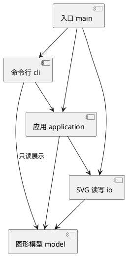

# Lab1 Phase 1 实验文档

本实验使用 TypeScript 实现命令行 SVG 编辑器。内置 `rect`、`circle`、`ellipse`、`line`、`text`、`g`，完成文档读写、图形编辑、树形显示和撤销重做。`box` 创建与插件加载属于后续阶段。

快速运行、示例命令见 [项目 README](../README.md)。原始要求见 [phase_cli_1.md](../phase_cli_1.md)。

## 一、架构方案

### 1. 模块划分与阅读顺序

| 目录 | 职责 | 主要类 |
|---|---|---|
| `src/cli/` | 逐行交互、引号分词、命令分发、文本展示 | `Repl`、`CommandParser`、`CommandArguments`、`CommandDispatcher`、`TreeRenderer` |
| `src/application/` | 文档生命周期、编辑用例和历史管理 | `Editor`、`History`、`commands/` 下的编辑命令 |
| `src/model/` | 图形行为、组合树及其结构规则 | `Shape`、六种图形类、`SvgDocument`、`ShapeFactory` |
| `src/io/` | SVG 与模型转换，读写文件 | `SvgCodec`、`SvgFileStore` |
| `src/main.ts` | 创建对象并连接各模块 | 程序入口 |
| `test/` | 功能、状态边界、CLI 和架构测试 | 使用 Node.js 内置测试工具 |
| `examples/` | 可回放命令和 SVG 示例 | 流程图、外部 SVG 和典型会话 |

组件图使用 PlantUML：



新人可先沿着一次移动操作阅读：

1. `main.ts` 创建 `Editor` 和 `Repl`。
2. `Repl` 将一行输入交给 `CommandDispatcher`。
3. `CommandParser` 处理双引号，`CommandArguments` 检查参数。
4. 分发表创建 `MoveCommand`，交给 `Editor.execute()`。
5. `History` 执行命令并保存历史。
6. `MoveCommand` 查找目标，调用 `shape.move()`。
7. 具体图形修改自身几何；`Group` 将操作递归传给子节点。

这样可以先理解一个完整功能，再阅读其余命令。

### 2. 设计模式及其落地

**Command 模式。** 编辑动作封装成 `EditCommand` 的子类，例如 `MoveCommand`、`DeleteCommand`、`GroupCommand`。每个命令保存参数，子类的 `apply()` 只描述本次编辑；基类提供 `execute()`、`undo()`、`redo()`。`front`、`back` 共用 `ReorderCommand`，通过方向参数区分。

`History` 管理撤销和重做栈：一条编辑命令对应一个历史单元。显示和文件操作不伪装成可撤销编辑，而是通过命令分发表直接调用应用入口。

**Composite 模式。** `Rect`、`Circle` 等叶子图形和 `Group` 都继承 `Shape`，统一提供 `move`、`scale`、`setAttribute`、`clone` 等操作。移动容器时递归调用子图形，不在命令层判断图形类型。普通 `g` 的样式保存在容器本身，由 SVG 渲染器实现继承，不覆盖子图形的显式颜色。

**快照方式保存历史。** 每次编辑先克隆文档，在副本上执行，成功后再替换当前文档并保存前后快照。撤销和重做恢复快照的克隆，避免共享可变对象。这样分组、删除子树都无需额外实现复杂逆操作，浮点缩放也能恢复原值。

快照空间随图形数量和历史条数增长；本阶段接受这一成本，暂不实现局部差量历史。

**简单图形工厂。** `ShapeFactory` 的一张定义表同时服务 CLI 创建与 SVG 导入，集中保存类型、几何参数和构造方法。工厂只创建对象，图形行为仍由类实现。

按任务要求，以下两处名称分派记为**待重构点**：

| 位置 | 当前方式 | 何时重构 |
|---|---|---|
| `CommandDispatcher` | 命令名到处理方法的 Map | 多交互入口或插件真正出现时开放注册 |
| `ShapeFactory` | 图形类型到构造定义的 Map | 后续 ShapeProvider 阶段开放类型注册 |

其余编辑操作依赖多态。容器能力检查使用 `instanceof Group`，不增加按图形名称分支的分派表。

### 3. 依赖方向规则

| 模块 | 允许依赖 | 理由 |
|---|---|---|
| `model` | 本模块 | 图形行为独立于终端、文件系统和 XML 库 |
| `io` | 本模块、`model`、Node.js 文件 API、XML 库 | 转换和保存图形模型 |
| `application` | 本模块、`model`、`io` | 组织编辑、文档生命周期和文件用例 |
| `cli` | 本模块、`application`、`model`、Node.js 交互 API | 调用应用入口并读取模型进行展示 |
| `main.ts` | 以上模块 | 负责组装对象 |

`cli` 只读取模型，不直接修改图形。`Editor` 负责组织流程，不计算每种图形的坐标。XML 库限制在 `SvgCodec` 中，模型通过只读传输结构 `SvgNode` 交换数据；该结构不是供编辑使用的公共数据袋。

本阶段应用层直接依赖具体的 `SvgFileStore`，不额外建立只有一种实现的仓库接口。

### 4. 变化点假设

| 可能变化 | 当前准备或暂缓理由 |
|---|---|
| 新增图形类型 | 统一 `Shape` 行为与集中工厂；暂不实现插件加载 |
| 增加 GUI 或 agent 入口 | 模型和编辑命令独立于 REPL，可复用应用层 |
| 更复杂的 SVG 导入 | XML 处理集中于 `SvgCodec`；目前明确限制支持范围 |
| 更大文档与更长历史 | 目前递归查找和整文档快照；实际出现性能问题再增加索引或差量历史 |
| 更换文件保存方式 | 文件系统操作集中于 `SvgFileStore`；暂不加入远程存储接口 |

### 5. 关键规则与补充约定

**坐标与顺序。** 子节点数组顺序对应 SVG 绘制顺序。`front` 移到数组末尾，`back` 移到开头。移动直接修改几何坐标；缩放同乘位置和尺寸，容器递归处理每个子孙。文字只缩放 `x/y`，本阶段没有可编辑的字号属性。

**分组。** 保持原树中的顺序，不按命令参数顺序重新排列。所选元素同属一个父节点时，新组放在原最早被选节点的位置；跨父节点时，按原树深度优先顺序排列子节点，新组追加到画布根。后者是原说明未明确的位置约定。选中祖先及其子孙、重复选择，以及把容器放进自身或子孙都报错。

**解组。** 按任务错误表，禁止解散画布的直接子容器；嵌套容器解组后，子节点按原顺序占据容器的位置。换父级与解组保留子图形自身属性，继承样式随新层级变化。

**历史边界。** 成功 `init`、`read`、`save` 或修改画布尺寸后，清空旧历史并禁止撤销重做，直到下一次成功编辑重新开始记录。清空旧历史是对原说明的补充约定，避免文件操作后恢复过期文档。无参数 `canvas` 只是查询。失败命令不改变文档、默认路径、历史栈或禁用状态。反馈使用简明摘要；撤销回显 `undone: <原操作摘要>`。

**路径。** `read` 成功后记录来源路径；`save 新路径` 成功后更新默认路径。新文档未指定路径时，裸 `save` 报错。相对路径以进程工作目录为准。

**交互。** `init [w] [h]` 按位置提供默认值 800、600；`canvas` 修改尺寸时必须同时给出宽高。允许未创建文档时使用 `help`，作为通用“其他命令须有文档”规则的交互例外。使用 `Ctrl+D` 结束，不额外增加退出命令。

**分词与错误。** 仅整行去掉前导空白后以 `#` 开头才视为注释，因此十六进制颜色不被截断。双引号保留带空格参数与空文本；引号内支持 `\"` 和 `\\`。只有未被引号包裹的尾部 `in <id>` 才作为父容器子句。REPL 统一将错误压成一行，以 `error:` 开头；批处理继续执行后续行，但最终返回退出码 1。

### 6. SVG 支持范围

支持六种内置元素、任意层数的 `g`、各类型几何属性、`fill`、`stroke`、`stroke-width` 和纯文本/CDATA 内容。未给出图形几何属性时按 SVG 零值处理；省略样式时不补写颜色。根节点要求正的 `width/height`（纯数值或 px），`viewBox` 可省略，给出时必须为 `0 0 width height`。支持 SVG 命名空间及其前缀写法，也接受无命名空间的简单文件。

读入缺 id 的图形时，先收集全文件的显式 id，再按“标签名+序号”分配，跳过碰撞并输出警告。重复显式 id 报错。外部 `g data-kind="box"` 降级为普通 `g`，保留子图形，后续保存不保留插件标记。

**不支持完整 SVG 标准。** 当前明确拒绝 `transform`、CSS/style、`path`、`use`、渐变、`tspan`、额外表现属性（如 `font-size`、`text-anchor`）、不匹配的 viewBox，以及 DOCTYPE。任务开头含 transform 的背景示例因此不在导入范围内；本阶段规定的六类图形命令和两节点流程图可以完整使用。遇到超出范围的元素或属性报错，避免静默丢掉内容。XML 注释与排版空白不属于模型，保存时不保留。

保存使用 XMLSerializer 处理转义，并为结构节点缩进，文字内容不额外插入空白。先写同目录临时文件，再替换目标；失败不更新文档状态和默认路径。

## 二、过程记录

| 阶段 | 发现的问题或取舍 | 实际处理与证据 |
|---|---|---|
| 需求梳理 | 说明中混有后续阶段 box 插件语义，容易扩大范围 | 将六种内置图形作为本阶段范围，`create box` 按规定报错 |
| 模型实现 | 各命令按类型判断会重复几何逻辑 | 建立 `Shape` 层次与 `Group`，首批模型测试验证嵌套移动、缩放、顺序与克隆隔离 |
| 历史实现 | 为分组、删除分别写逆操作容易漏掉原父级与顺序 | 采用 Command 配合前后快照，测试一次撤销恢复整棵子树 |
| 原子性检查 | 只在操作前验证参数，仍可能在递归缩放中途溢出 | 在工作副本执行；构造大数溢出案例，确认前面的子图形修改也不会泄漏 |
| 导入实现 | 一边读取一边补 id，可能与后面显式的 rect1 碰撞 | 改为先扫描显式 id，再分配自动 id；用嵌套 SVG 测试 |
| CLI 实现 | 空格切分会破坏文字；把 # 当行内注释会截断颜色 | 编写保留引号信息的分词器，测试空文本、中文、转义、颜色和 in 子句 |
| 范围自查 | 根节点混入普通文字可能被静默忽略 | 增加明确拒绝和回归案例，失败读取保留原文档 |
| 架构自查 | TypeScript 7 的默认导出不再提供旧版编译器 AST API | 不为检查工具引入额外依赖，改用针对本项目静态 import 写法的简单边界检查 |
| 实际回放 | 自动化检查不能替代交互与浏览器观察 | 回放任务典型会话和流程图；检查真实终端提示符、中文输出及浏览器中的图形与连线 |

Git 按模型、命令与 IO、CLI 与回放测试、最终文档与验收分步记录，保留开发过程。远程仓库为 `averyverylongname/lab1-svg-editor`，通过本地已有 SSH 认证推送。

## 三、一致性自查

**模块划分：与方案一致。** 实际保留四个模块与入口；增加 `CommandArguments` 分担参数读取，`SvgNode` 作为模型到 XML 的传输类型，具体编辑命令位于 `application/commands/`。这些都是模块内细分，没有额外框架或插件模块。

**依赖方向：当前检查未发现违反规则的静态 import。** `test/architecture.test.mjs` 检查实际源码中的静态导入，以及类名与文件名一致、每文件最多一个导出的类。检查范围是当前源码写法，不宣称是通用 TypeScript 依赖分析器。

人工抽样结果：

- `MoveCommand` 只调用模型操作，不接触 DOM 或终端。
- `Shape`、`Group`、`SvgDocument` 不导入文件系统或应用层。
- `SvgCodec` 使用模型传输结构，XML 库未进入模型。
- `TreeRenderer` 只读取模型，编辑通过 `Editor.execute()` 执行。

修订记录：跨父节点分组位置、文档操作清空历史、save 更新默认路径、help 无文档可用和导入子集，均已在本文件明确记录；整文档快照和线性查找的成本也已注明。

## 四、质量保证手段

在项目根目录执行：

```sh
npm ci
npm test
npm run cli --silent < examples/flowchart.commands
```

`npm test` 先进行严格 TypeScript 编译，再使用 Node.js 内置测试工具。当前包含 18 项顶层测试，内部对多条命令和错误情形逐项断言，无跳过项。

| 验证对象 | 对应证据 |
|---|---|
| 六种图形、多态和嵌套移动缩放 | `test/model.test.mjs` |
| create/delete/move/scale/set/group/ungroup/addto/front/back | 模型、历史及 CLI 状态断言 |
| tree/show/help、画布查询与修改 | `test/cli.test.mjs`、历史边界测试 |
| 一条命令一个撤销单元、redo 清空、快照隔离 | `test/history-io.test.mjs` |
| 失败编辑和失败 IO 不改变状态 | 失败前后模型比较，并实际使用 undo/redo 检查历史仍可用 |
| init/read/save/canvas 修改后的历史禁用 | `test/history-io.test.mjs` |
| 自动补 id、重复 id、特殊文字、命名空间与 SVG 往返 | XML 内容及读回模型断言 |
| 规定错误消息与参数边界 | CLI 多组用例逐条匹配错误并检查文档未变 |
| 真实进程、带空格路径、脚本错误退出码 | 子进程回放测试 |
| 模块边界、一类一文件 | `test/architecture.test.mjs` |
| 示例实际显示 | 浏览器渲染 `flowchart.svg`，检查两个矩形、中文标签与连线 |

典型会话脚本包含两次预期错误：祖先和子孙同时分组，以及保存后撤销，因此其退出码为 1；流程图脚本应以 0 结束。两者分别检验异常路径和正常完整流程。

当前验证不等于完整 SVG 兼容性证明。明确的限制是上述导入子集，以及小文档规模下的快照与遍历方案；没有将未实现的插件、GUI 或完整 SVG 标准列为已完成。
